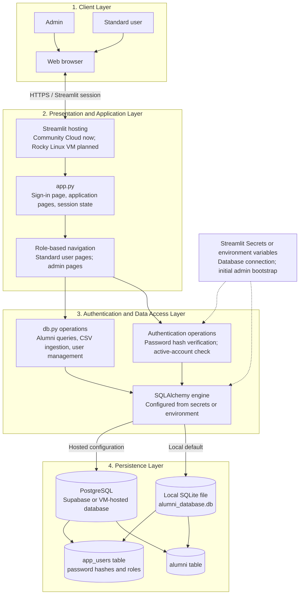

# Alumni Database Application Architecture

## Overview

The application is a small, server-rendered Streamlit system organized into four logical layers. A browser sends user actions to the Streamlit application. The application handles pages, session state, authentication flow, and role-specific navigation. Database operations are centralized in `db.py`, which uses SQLAlchemy to connect to either a local SQLite file or a configured PostgreSQL database such as Supabase.

The Rocky Linux VM is a planned deployment target. The current design can run there by supplying the database and bootstrap-admin settings through environment variables; the VM is not itself a separate application layer.

## Layered Architecture Diagram

## Layer Responsibilities

| Layer | Current implementation | Responsibility |
|---|---|---|
| Client | Web browser | Presents the Streamlit app to admins and standard users. |
| Presentation and application | `app.py` | Renders sign-in and application pages, keeps the signed-in identity in Streamlit session state, checks active status on reruns, and displays pages according to role. |
| Authentication and data access | `db.py` | Creates salted scrypt password hashes, verifies credentials, bootstraps the initial administrator, manages user accounts, performs alumni queries, and ingests CSV data. |
| Persistence | SQLite or PostgreSQL | Stores alumni records in `alumni` and account credentials/roles in `app_users`. |
| Configuration | Streamlit Secrets or environment variables | Supplies database connection settings and one-time initial-admin credentials without embedding secrets in source code. |

## Main Request Flows

### Sign-In

1. The browser submits a username or email and password to the Streamlit app.
2. `app.py` calls the authentication operation in `db.py`.
3. `db.py` loads the active account, verifies its stored scrypt hash, and updates the last-login timestamp.
4. The app stores the authenticated account ID in Streamlit session state and renders role-appropriate navigation.
5. On later reruns, the app rechecks that the account is active; deactivated or deleted accounts are signed out.

### Alumni Search and Analytics

1. The browser submits filters or opens the analytics page.
2. `app.py` builds or selects the requested operation and calls `db.py`.
3. SQLAlchemy executes parameterized queries against the configured database.
4. Results return to Streamlit for display or CSV download.

### Admin CSV Ingestion and User Management

1. An admin selects an upload or user-management action in the Streamlit interface.
2. `app.py` validates the submitted form and calls the relevant `db.py` operation.
3. `db.py` inserts or updates alumni by email, or creates/updates/deletes user accounts.
4. The operation result is returned to the admin interface for confirmation.

## Interface Overview

The user interface is primarily focused on interaction between authenticated users and the alumni database. After login, the Search & Filter page provides search fields and filters above a table of matching alumni. Users can search by name or company and filter by major, LinkedIn status, graduation year, or questionnaire responses. The sidebar provides Search & Filter, Analytics, View All Data, and sign-out navigation. Admins also see Upload / Ingest CSV, User Management, and Settings. Users can export search results or all alumni records as CSV files, while admins can preview and import a CSV to add new alumni or update existing records by email.

## Example User Workflow

A user signs in with their username or email and password and is taken to the Search & Filter page. They can type a name or company, choose filters, and view the matching alumni in the table. They can then visit Analytics to review summary counts and charts, or View All Data to browse and download the full alumni table. The current application does not provide individual alumni detail pages or an alumni request/checkout workflow; those would be future features.

## Example Admin Workflow

An admin signs in and uses the additional sidebar pages. To import alumni, the admin opens Upload / Ingest CSV, selects a file, reviews its preview, and confirms the import. The application reports how many records were added, updated, or skipped. To manage access, the admin opens User Management to create accounts, edit account details and roles, reset passwords, deactivate/reactivate accounts, or confirm account deletion. Settings provides the database location and columns, plus a confirmed action to clear alumni records. The application reports outcomes or validation errors in the page; it does not currently use a separate request-approval screen or popup workflow.

## Deployment and Database Configuration

- **Local development:** SQLAlchemy uses `alumni_database.db` when no database URL is configured.
- **Streamlit Community Cloud:** Streamlit Secrets supply the Supabase PostgreSQL connection details and initial-admin bootstrap settings.
- **Rocky Linux VM (planned):** The same Streamlit entry point can be run as a service. Provide database and bootstrap settings through service environment variables. The database may be PostgreSQL on Supabase or a separately operated PostgreSQL server.
- **Database choice:** The `DATABASE_URL` configuration selects the backend. `db.py` uses SQLAlchemy so the application query code can work against SQLite or PostgreSQL.

## Current Design Boundary

This is a compact prototype, not a multi-service system. Presentation and workflow handling live together in `app.py`; authentication, account management, and alumni data operations live together in `db.py`. There is no separate REST API or independently deployed authentication service. A later Rocky Linux production deployment should additionally configure HTTPS, restrict database network access, protect environment secrets, and back up PostgreSQL data.

## Subsystem Decomposition

### IV.1.4.1.[Login Subsystem]

#### Description

- Authenticates active users and admins using a username or email address and password.
- Stores salted scrypt password hashes rather than plaintext passwords.
- Maintains the signed-in identity in Streamlit session state and ends access when an account becomes inactive or is deleted.

#### Concepts and Algorithms Generated

- Password hashing and verification using Python's `hashlib.scrypt` and constant-time comparison with `hmac.compare_digest`.
- Role-based authorization for standard-user and admin navigation.
- Initial-admin bootstrap from deployment secrets when the user table is empty.

#### Interface Description

- Users enter a username or email and password in a Streamlit sign-in form.
- A successful sign-in stores the account identity in the Streamlit session and displays pages allowed for that role.
- An unsuccessful sign-in displays an error and leaves the user on the sign-in page.
- Sign-out clears the authenticated identity from the session.
- This subsystem uses Streamlit forms and Python calls; it does not expose separate POST/GET API routes.

#### Services Provided

- **Service name:** Authenticate User
- **Service provided to:** Streamlit sign-in page and role-based application flow
- **Description:** Verifies credentials for an active account and records the successful login time.

- **Service name:** Revalidate Session
- **Service provided to:** Authenticated application pages
- **Description:** Confirms the account remains active before rendering the application.

#### Services Required

- **Service name:** Streamlit forms and session state
- **Provider:** Streamlit
- **Service name:** Password hashing and constant-time comparison
- **Provider:** Python standard library (`hashlib`, `hmac`)
- **Service name:** Account lookup and database connection
- **Provider:** `db.py`, SQLAlchemy, and the configured database

### IV.1.4.2.[User Management Subsystem]

#### Description

- Allows admins to create, view, edit, deactivate, reactivate, and delete application accounts.
- Supports assigning either the admin or standard-user role and resetting passwords.
- Protects the system against loss of its final active admin account and prevents an admin from locking themselves out through self-management.

#### Concepts and Algorithms Generated

- Unique username and email validation.
- Password length validation and salted scrypt hashing for new or reset passwords.
- Account lifecycle and role checks, including protection of the last active admin.

#### Interface Description

- Admins open the User Management page, which lists current accounts and provides account-creation and account-edit forms.
- Admins explicitly confirm account deletion.
- The interface reports validation failures, duplicate identifiers, and account-management safeguards.
- Standard users do not receive this page in their navigation.

#### Services Provided

- **Service name:** Create User
- **Service provided to:** Admin account-creation form
- **Description:** Creates an account with a unique username and email, selected role, and hashed password.

- **Service name:** Update User
- **Service provided to:** Admin account-edit form
- **Description:** Updates account identifiers, role, active status, or password.

- **Service name:** Delete User
- **Service provided to:** Admin account-management page
- **Description:** Deletes a confirmed account unless doing so would remove the final active admin or the current admin account.

#### Services Required

- **Service name:** Streamlit forms, tabs, and controls
- **Provider:** Streamlit
- **Service name:** User CRUD and validation operations
- **Provider:** `db.py`
- **Service name:** Persistent account storage and uniqueness constraints
- **Provider:** SQLAlchemy and the configured SQLite or PostgreSQL database

### IV.1.4.3.[Alumni Search and Records Subsystem]

#### Description

- Searches, filters, displays, and exports alumni records for authenticated users.
- Supports filtering by name, company, major, LinkedIn presence, graduation year or range, and questionnaire answers.

#### Concepts and Algorithms Generated

- Parameterized SQL queries for search and filter criteria.
- Dynamic filter creation from questionnaire columns in the alumni table.
- CSV serialization of filtered results or all records, excluding internal row IDs from downloads.

#### Interface Description

- Users enter search text and select filters on the Search & Filter page.
- Matching records are displayed in a table, with a CSV download action when results exist.
- The View All Data page displays all records and offers a full-table CSV download.
- Standard users and admins can access search and record-viewing functions.

#### Services Provided

- **Service name:** Search Alumni
- **Service provided to:** Search & Filter page
- **Description:** Returns records matching the requested filters.

- **Service name:** List and Export Alumni
- **Service provided to:** View All Data page and search results
- **Description:** Returns alumni records and serializes available results as CSV.

#### Services Required

- **Service name:** Search controls and data tables
- **Provider:** Streamlit
- **Service name:** Query result handling and CSV serialization
- **Provider:** pandas
- **Service name:** Alumni query execution
- **Provider:** `db.py`, SQLAlchemy, and the configured database

### IV.1.4.4.[Analytics Subsystem]

#### Description

- Summarizes alumni records and survey engagement for authenticated users.

#### Concepts and Algorithms Generated

- Aggregate queries for total alumni, distinct companies, and distinct majors.
- Grouping by graduation year, questionnaire answer, company, and major.
- Top-ten ordering for company and major summaries.

#### Interface Description

- Users open the Analytics page to view summary metrics and charts.
- Questionnaire response charts are generated for the questionnaire columns currently in the database.
- Empty datasets or categories are handled with an empty-state message or without a chart.

#### Services Provided

- **Service name:** Alumni Summary Metrics
- **Service provided to:** Analytics page
- **Description:** Supplies headline totals and category counts.

- **Service name:** Engagement Charts
- **Service provided to:** Analytics page
- **Description:** Supplies grouped data for graduation-year, questionnaire, company, and major charts.

#### Services Required

- **Service name:** Aggregate query execution
- **Provider:** `db.py`, SQLAlchemy, and the configured database
- **Service name:** Metrics and chart rendering
- **Provider:** pandas and Streamlit

### IV.1.4.5.[CSV Ingestion Subsystem]

#### Description

- Allows admins to upload alumni CSV data, review a preview, and explicitly confirm ingestion.
- Inserts new alumni, updates existing records by email, and reports skipped rows.

#### Concepts and Algorithms Generated

- CSV parsing and column-name normalization.
- Email-based matching to prevent duplicate alumni records.
- Automatic addition of newly supplied columns, including questionnaire columns.
- Normalization of common yes/no response values.

#### Interface Description

- Admins select a CSV file on the Upload / Ingest CSV page and review a preview before confirming.
- The upload must contain an email column.
- The page reports inserted, updated, and skipped row counts.
- Standard users cannot access the ingestion page.

#### Services Provided

- **Service name:** Preview CSV
- **Service provided to:** Admin upload page
- **Description:** Parses an uploaded CSV and displays an initial preview.

- **Service name:** Ingest Alumni Data
- **Service provided to:** Admin upload page
- **Description:** Inserts or updates valid rows and returns ingestion counts.

#### Services Required

- **Service name:** File upload and preview UI
- **Provider:** Streamlit
- **Service name:** CSV parsing and dataframe transformation
- **Provider:** pandas
- **Service name:** Schema changes and record persistence
- **Provider:** `db.py`, SQLAlchemy, and the configured database

### IV.1.4.6.[Persistence and Configuration Subsystem]

#### Description

- Provides persistent storage for alumni and application accounts.
- Selects local SQLite or configured PostgreSQL based on deployment configuration.
- Supplies database and initial-admin settings without placing credentials in source code.

#### Concepts and Algorithms Generated

- SQLAlchemy connection and transaction handling.
- Database initialization for the `alumni` and `app_users` tables.
- Database URL selection from split Supabase settings, `DATABASE_URL`, or the local SQLite fallback.

#### Interface Description

- Application operations call the data functions in `db.py`; browser clients do not connect directly to the database.
- Local development uses the `alumni_database.db` file when no database connection setting is supplied.
- Hosted deployment reads database settings from Streamlit Secrets or environment variables.
- A Rocky Linux service can provide the same settings as environment variables.

#### Services Provided

- **Service name:** Store and Retrieve Records
- **Service provided to:** Authentication, user management, search, analytics, and CSV ingestion subsystems
- **Description:** Persists and queries rows in the `alumni` and `app_users` tables.

#### Services Required

- **Service name:** Database engine and SQL execution
- **Provider:** SQLAlchemy
- **Service name:** Local relational storage
- **Provider:** SQLite
- **Service name:** Hosted relational storage, when configured
- **Provider:** PostgreSQL, such as Supabase or a Rocky Linux-hosted PostgreSQL server
- **Service name:** Deployment configuration secrets
- **Provider:** Streamlit Secrets locally/Community Cloud, or protected environment variables on Rocky Linux
