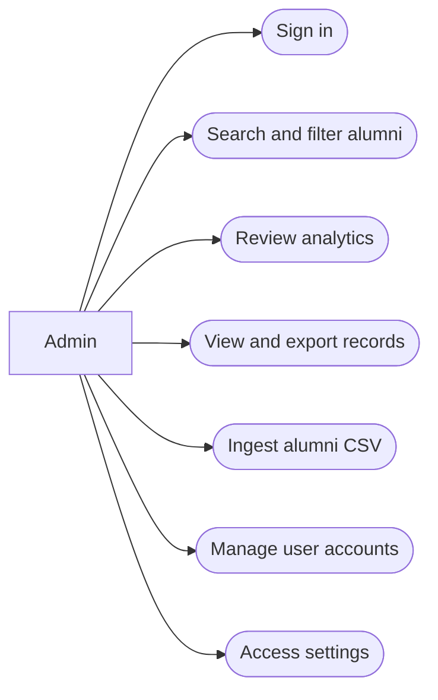
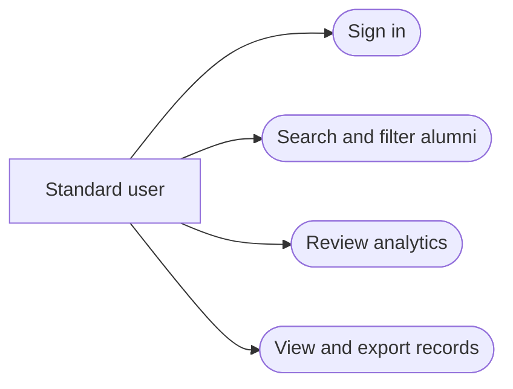

# Alumni Database App Use Cases

These use cases describe the current role-based Streamlit application. A **standard user** can search alumni, view analytics, and view or export records. An **admin** can do those tasks and additionally ingest CSV files, manage user accounts, and access settings.

## Admin Use Case Diagram

## Standard User Use Case Diagram

## UC-01: Sign In

**Use Case**  
Sign in to the alumni database application.

**Actors**  
Primary: Standard user or admin. Supporting: Application and database.

**Pre-condition**  
- The application and database are available.
- The actor has an existing, active account.

**Post-condition**  
- The actor is authenticated for the current application session.
- The user's last-login timestamp is updated.
- The pages available to the actor match their assigned role.

**Main Flow**  
1. The actor opens the application.
2. The application displays the sign-in page.
3. The actor enters their username or email and password.
4. The application verifies the password hash and confirms the account is active.
5. The application opens the role-appropriate pages.

**Alternative Flow**  
- If the username/email or password is incorrect, the application displays a sign-in error and keeps the actor on the sign-in page.
- If the account is inactive, the application denies sign-in.
- If no account exists, the application displays a setup message; an administrator must configure the initial bootstrap credentials.

**Related Requirements**  
- AUTH-01: Store password hashes, never plaintext passwords.
- AUTH-02: Allow sign-in by username or email for active accounts only.
- AUTH-03: Restrict pages according to the authenticated user's role.

## UC-02: Search and Filter Alumni

**Use Case**  
Find alumni records matching selected search criteria.

**Actors**  
Primary: Standard user or admin. Supporting: Application and alumni database.

**Pre-condition**  
- The actor is signed in with an active account.
- Alumni records may or may not exist.

**Post-condition**  
- Matching records, or an empty result, are displayed.
- No database records are changed.

**Main Flow**  
1. The actor opens Search & Filter.
2. The actor optionally enters a first or last name and/or current company.
3. The actor optionally selects one or more majors, LinkedIn status, graduation year or range, and questionnaire responses.
4. The application applies the selected criteria and displays matching records.
5. The actor may download the matching results as a CSV file.

**Alternative Flow**  
- If no records match, the application displays zero results.
- If the database has no alumni records, the application directs the actor to contact an admin to ingest data.
- If no filters are selected, the application displays all alumni records in the search results.

**Related Requirements**  
- ALUM-01: Search and filter records using supported alumni and questionnaire fields.
- ALUM-02: Permit authenticated users to export search results as CSV.

## UC-03: Review Alumni Analytics

**Use Case**  
Review summary statistics and charts about alumni and survey responses.

**Actors**  
Primary: Standard user or admin. Supporting: Application and alumni database.

**Pre-condition**  
- The actor is signed in with an active account.
- Alumni records may or may not exist.

**Post-condition**  
- Available summary metrics and charts are displayed.
- No database records are changed.

**Main Flow**  
1. The actor opens Analytics.
2. The application displays total alumni, distinct companies, and distinct majors.
3. The application displays graduation-year distribution, questionnaire response counts, top companies, and top majors when data is available.
4. The actor reviews the displayed summaries.

**Alternative Flow**  
- If there are no alumni records, the application displays a message that data must be added before analytics are available.
- If a particular category has no values, the related chart is omitted or reports that no responses are available.

**Related Requirements**  
- ANALYTICS-01: Display alumni, company, and major counts.
- ANALYTICS-02: Summarize graduation years, questionnaire responses, companies, and majors.

## UC-04: View and Export Alumni Records

**Use Case**  
View the full alumni table and optionally export it.

**Actors**  
Primary: Standard user or admin. Supporting: Application and alumni database.

**Pre-condition**  
- The actor is signed in with an active account.

**Post-condition**  
- The application displays the available alumni records.
- If requested and records exist, a CSV export is downloaded.
- No database records are changed.

**Main Flow**  
1. The actor opens View All Data.
2. The application displays alumni records ordered by last name and first name.
3. The actor optionally selects Download all data as CSV.
4. The application provides a CSV containing the displayed records, excluding the internal row ID.

**Alternative Flow**  
- If there are no records, the application displays an empty table and does not offer an export.

**Related Requirements**  
- ALUM-03: Allow authenticated users to view all alumni records.
- ALUM-04: Export the full alumni table as CSV without exposing internal IDs.

## UC-05: Ingest Alumni CSV

**Use Case**  
Add or update alumni records by uploading a CSV file.

**Actors**  
Primary: Admin. Supporting: Application and alumni database.

**Pre-condition**  
- The actor is signed in with an active admin account.
- The CSV includes an email column used to identify alumni.

**Post-condition**  
- Rows with new email addresses are inserted.
- Rows whose email addresses already exist are updated.
- Rows without email values are skipped and counted.
- Newly supplied questionnaire columns are added to the database.

**Main Flow**  
1. The admin opens Upload / Ingest CSV.
2. The admin selects a CSV file.
3. The application parses the file and displays a preview.
4. The admin confirms ingestion.
5. The application inserts new records, updates matching records, skips rows missing email, and displays a summary.

**Alternative Flow**  
- If the file cannot be parsed, the application displays an error and does not ingest it.
- If the file has no email column, ingestion is rejected with a validation error.
- If individual rows have missing email values, those rows are skipped while other valid rows are processed.
- The admin may load the included sample dataset instead of uploading a file.

**Related Requirements**  
- ADMIN-01: Restrict CSV ingestion to admins.
- DATA-01: Require email as the unique matching key for CSV ingestion.
- DATA-02: Insert new records and update existing records by email.
- DATA-03: Add new questionnaire columns from uploaded CSV files.

## UC-06: Manage User Accounts

**Use Case**  
Create, edit, deactivate, reactivate, or delete application accounts.

**Actors**  
Primary: Admin. Supporting: Application and user database.

**Pre-condition**  
- The actor is signed in with an active admin account.
- The actor opens User Management.

**Post-condition**  
- A valid account is created, updated, deactivated/reactivated, or deleted.
- New or reset passwords are stored only as salted hashes.
- Role and active-status changes are enforced on subsequent application reruns.

**Main Flow**  
1. The admin opens User Management.
2. To create an account, the admin enters a unique username, unique email, password of at least 12 characters, and role, then submits the form.
3. To edit an account, the admin selects a current user and changes username, email, role, active status, and optionally the password.
4. To delete an account, the admin selects the account, confirms deletion, and submits the delete action.
5. The application validates the request, saves the permitted change, and displays a result.

**Alternative Flow**  
- If a username or email is already in use, the application rejects the change and displays an error.
- If required account fields are invalid or a new password is shorter than 12 characters, the application rejects the change.
- The application prevents an admin from deleting, demoting, or deactivating their own account.
- The application prevents deleting or deactivating the last active admin.
- If an account is deactivated while its owner is signed in, the application invalidates that session on its next rerun.

**Related Requirements**  
- ADMIN-02: Restrict user management to admins.
- USER-01: Allow admins to create accounts with unique usernames and emails.
- USER-02: Allow admins to edit roles, active status, profile identifiers, and passwords.
- USER-03: Allow admins to delete accounts with confirmation.
- USER-04: Preserve at least one active admin and prevent self-lockout.
- AUTH-01: Store password hashes, never plaintext passwords.
